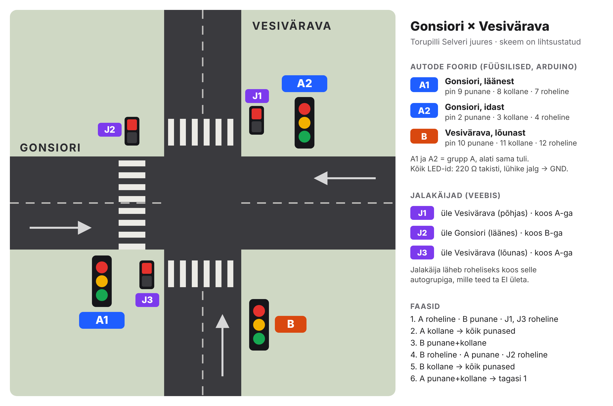

# Arduino_Foor
Internet of Things final project - Traffic simulation.

FAILID
- foorid/foorid.ino – Arduino kood (laadi Arduino IDE-ga plaadile)
- foor/index.html, foor/style.css, foor/script.js – veebileht (ava Chrome'is)
- ristmik.png / ristmik.svg – ristmiku skeem fooride nimedega

ARDUINO ÜHENDUSED (fooriLED-moodulid, leivalaua kaudu)
- Moodul A (grupp A, näitab A1 ja A2): R → a12 → e12 → pin 9, Y → a13 → e13 → pin 8, G → a14 → e14 → pin 7
- Moodul B (grupp B, Vesivärava):      R → a3 → e3 → pin 10,  Y → a4 → e4 → pin 11,   G → a5 → e5 → pin 12
- Mõlema mooduli GND → leivalaua sinine (−) rada → Arduino GND
- Pinnid 2, 3, 4 (A2) on varuks, füüsilist moodulit pole
- Kontroll: pärast üleslaadimist ja ühendamist peab veebi logis olema ← {"ready":1,"v":"2026-11-23"}

JALAKÄIJAD (veebis)
- J1: üle Vesivärava (põhjas), roheline koos A-ga
- J2: üle Gonsiori (läänes), roheline koos B-ga
- J3: üle Vesivärava (lõunas), roheline koos A-ga

AJASTUS JA REŽIIMID

ÜLDREEGLID (kõigis režiimides)
- Kollane: 3 s
- Punane + kollane: 2 s
- Kõik punased (turvaaeg faaside vahel): 2 s
- Jalakäija roheline: vähemalt 7 s
- Jalakäija vilkuv roheline: 4 s (enne punast)

HOMMIKUREŽIIM (kell 06:00–10:00)
Põhjendus: palju autosid sõidab Gonsiori kaudu kesklinna, jalakäijaid vähe.
- A roheline: 40 s
- B roheline: 15 s
- Jalakäijad: ainult nupuvajutusel (veebis)
- Tsükkel kokku umbes 70 s

ÕHTUREŽIIM (kell 10:00–23:00)
Põhjendus: autod sõidavad mõlemas suunas, Selveri juures palju jalakäijaid.
- A roheline: 30 s
- B roheline: 25 s
- Jalakäijad: roheline igas tsüklis automaatselt, nupp lühendab ooteaega
- Tsükkel kokku umbes 75 s

ÖÖREŽIIM (kell 23:00–06:00)
Põhjendus: liiklust on vähe, pole mõtet autosid punase taga hoida.
- A ja B: kollane vilgub (1 s põleb, 1 s kustus)
- Jalakäijate foorid: kustus
- Nupp ei tööta

VEEBINUPU LOOGIKA
1. Kasutaja vajutab veebis jalakäija nuppu (J1, J2 või J3).
2. Ekraanil süttib "OOTA".
3. Programm ootab, kuni algab faas, kus see jalakäija tohib minna.
4. Jalakäija foor läheb roheliseks, siis vilgub, siis punane.
5. "OOTA" kustub.
- Hommikul: ilma nupuvajutuseta jalakäija rohelist ei saa.
- Õhtul: nupp lühendab käimasoleva auto rohelise (kuid mitte alla 10 s).

REŽIIMI VALIK
- Automaatne: veebileht vaatab arvuti kellaaega.
- Käsitsi: veebis nupud "Hommik / Õhtu / Öö" esitluse jaoks
  (et ei peaks ootama õiget kellaaega).

ANDMETE LIIKUMINE
- Veebileht = juht: otsustab faasid, režiimi ja jalakäijad.
- Arduino = täitja: süütab füüsiliste fooride tuled.
- Veeb → Arduino: {"A":"G","B":"R"}      (iga faasivahetuse ajal)
- Arduino → veeb:  {"ack":"A:G,B:R"}      (kinnitus)
- Režiimi vahetus: {"mode":"night"}       (Arduino hakkab ise kollast vilgutama)